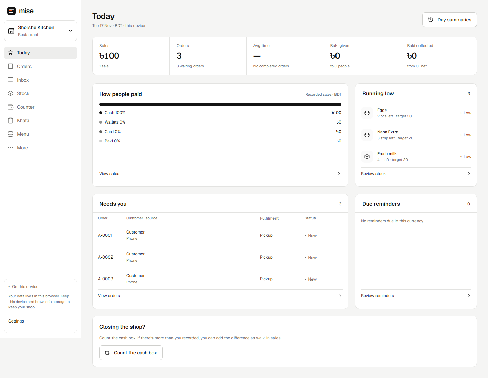
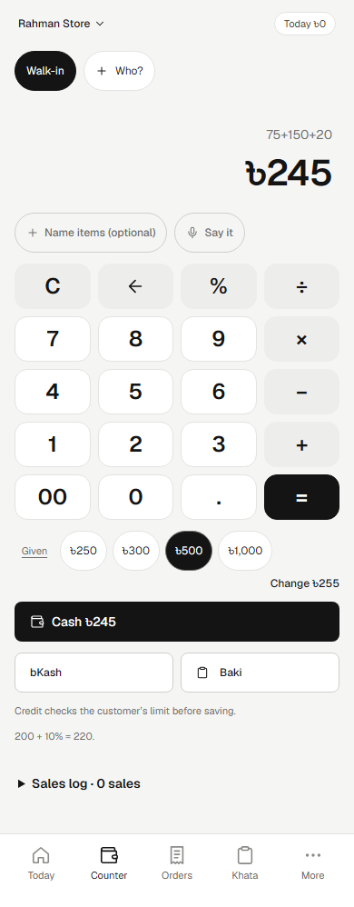
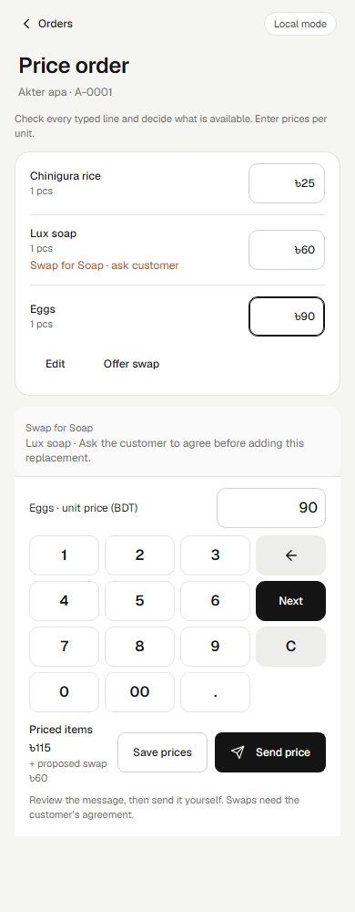

# Mise

**Every order, chat and payment, in one calm place.**

Mise is a workspace for the everyday work of a small business: taking orders, making sales, counting stock, keeping customer credit and closing the cash box. It is built for restaurants, corner shops, food stalls and online sellers whose business happens across a counter and a handful of chats.

Start on the phone or computer you already have. The app works offline after its first load, without an account. Your shop records stay in that browser, with exports and a complete backup you can take with you.

[**Open the app**](https://tanzir71.github.io/mise/app/) · [Bangladesh](https://tanzir71.github.io/mise/bd/) · [International](https://tanzir71.github.io/mise/intl/) · [Roadmap](handover/docs/03-roadmap.md)



## A whole shift, together

A customer sends a list on WhatsApp. Paste it into Mise, check the items and prices, and create the order. Record a walk-in sale at the counter, or put an agreed amount on a neighbour’s khata. Count what is running low, draft the supplier request and close the day against the cash actually in the box.

The work stays connected, and the next step stays visible.

| At the shop | What Mise helps you do |
| --- | --- |
| **Counter** | Add amounts like a calculator, record cash quickly, work out change and prepare a receipt. |
| **Orders** | Review pasted requests, enter prices, keep a queue and move each order through its stages. |
| **Khata / baki** | Keep customer balances and credit limits, record collections and prepare reminders. |
| **Stock** | Track what you have and need, review updates such as “used 2 kg chicken”, and do a night count. |
| **Today & closing** | See sales, waiting orders, low stock and credit activity; count the cash box and review differences. |
| **Customer links** | Share a menu or order page. Customers send a structured WhatsApp request in English or Bangla. |
| **Your records** | Export CSV, Excel or PDF reports, and download or restore a complete JSON backup. |

<table>
  <tr><th>Cash at the counter</th><th>Price a customer’s request</th></tr>
  <tr>
    <td></td>
    <td></td>
  </tr>
</table>

*Screenshots are from the working app, using sample shop data.*

## Bangladesh first, useful elsewhere

Mise understands the routines around **khata and baki**, Bangladesh phone numbers, taka and lakh grouping. Customer messages support Bangla and English, with local fonts for Bengali text. Market packs adapt currency, time zone, payment labels and business vocabulary for other markets.

The design stays calm: monochrome surfaces, clear amounts, visible status and controls made for fingers as well as a keyboard.

## Automation with a way back

Sending a message is a hand-off you control: open the other app, copy the message, or mark it done yourself. Opening WhatsApp does not pretend a message was sent. Financial actions need an explicit confirmation, and recorded history keeps corrections traceable.

The longer-term goal is an AI operator that can help run the shift through the same permissioned, audited actions. Shared devices and sync come first; OCR, capture integrations and agent operation follow in later phases.

## Where the build stands

The landing pages and the app for one device are implemented, along with public shop links and paste-to-order review. Android sharing into a local Inbox and printable QR tools are staged behind feature flags while their device checks remain open.

Accounts, sync, kitchen/staff screens, automatic capture and AI operators are on the [milestone roadmap](handover/docs/03-roadmap.md). The [changelog](CHANGELOG.md) and delivery notes record the implementation and its verification.

GitHub workflows are disabled at the owner’s request, so `main` can be ahead of the published Pages site.

## Run locally

Use **Node 20.19+** and **pnpm 10**; the repository pins its pnpm version.

```sh
git clone https://github.com/tanzir71/mise.git
cd mise
pnpm install --frozen-lockfile
pnpm dev:web
```

Open the app at **http://127.0.0.1:5173/app/**. In another terminal, run `pnpm dev:landing` for the landing site at **http://127.0.0.1:4321/**.

For a combined production preview:

```sh
pnpm build
pnpm preview
```

The static build is written to `site/`. The default base path is `/`; set `BASE_PATH=/mise/` when building for this GitHub Pages repository. Configuration is documented in [.env.example](.env.example). For your own deployment, see the [self-hosting guide](docs/deploy-own-vercel.md).

Keep deployment values in ignored environment/private files or the server's secret manager. Only blank templates belong in Git. Run `pnpm security:install-hooks` once per clone to enable local commit and push protection. Commits scan source and staged files; pushes also scan reachable history and built output. Lint and production builds run the same redacting secret guard. For a full manual audit, run `pnpm check:secrets --history --artifacts`. See the [credential handling and audit notes](docs/security.md).

## Inside the repository

```text
apps/landing    Astro landing pages and setup/downloads site
apps/web        React app, PWA and customer shop pages
packages/core   TypeScript domain rules, parsers and market packs
packages/ui     Shared design tokens, fonts, icons and primitives
handover        Product brief, designs, copy and milestone specifications
```

Before browser checks, install Chromium with `pnpm exec playwright install chromium`. Run `pnpm lint`, `pnpm typecheck`, `pnpm test` and, after building, `pnpm e2e`. The visual comparison report is generated by `pnpm qa:visual` at `qa/report.html`.

Start with the [product brief](handover/docs/00-product-brief.md), [architecture](handover/docs/04-architecture.md) and [repository instructions](AGENTS.md) when working on a milestone.

---

Built by [tanziro.com](https://tanziro.com).
