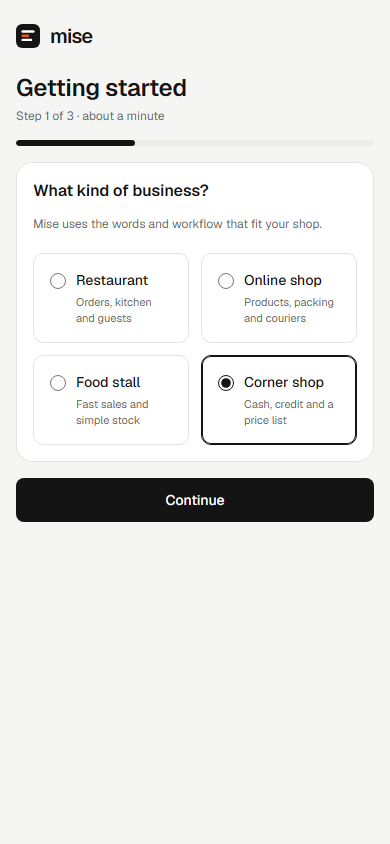
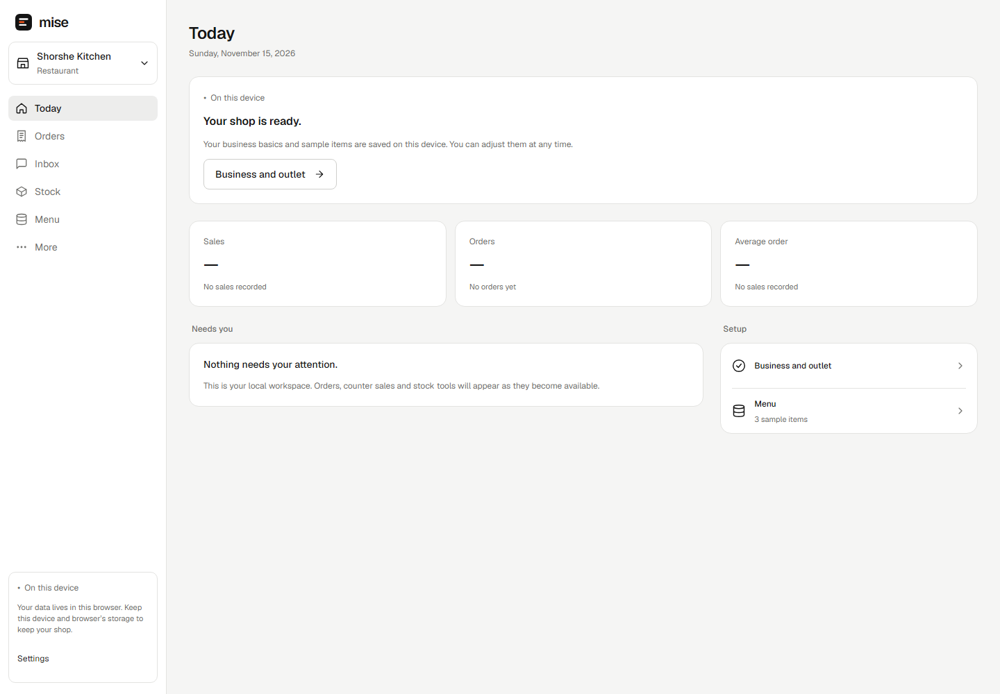
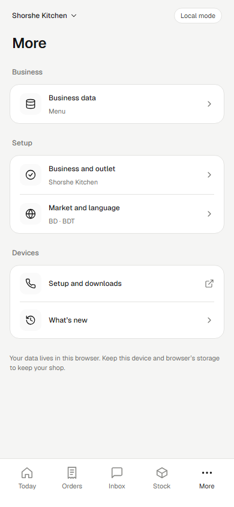

# M10 · Local setup and app shell

Delivered directly to main under the owner's updated workflow. The earlier data-foundation increment is recorded in PR #15; no further PR is required.

The app starts with three questions: business type, market, then shop name and phone. The profile, sample items and audit event persist atomically in IndexedDB. Settings support business/outlet details, customer-message language and currency preview. The desktop sidebar is 240px; phone navigation and catalogue nouns follow the selected business. Sample items can be removed without exposing unfinished catalogue editing.

The shell can navigate, reload and save profile changes offline after its first load. Cached updates wait for an explicit reload. Installation manifests, install coaching and storage-persistence controls remain scheduled for M18. Counter, order, khata and stock pages currently explain that their tools are being prepared; they do not show fabricated activity.

## Validation

- Lint and strict TypeScript/Astro checks.
- 36 unit tests, including exact minor-unit formatting, phone formats, atomic persistence, rollback and audited sample removal.
- 66 browser checks, including three-step setup, changing pack labels, reload persistence, offline navigation/save, five viewport widths and axe AA for the new app/forms.
- 72 visual comparisons: the existing 64 landing/setup comparisons plus eight M10 captures.
- Export/source/payload guards remain in the production build.

The visual report is uploaded as `visual-qa` by [main CI](https://github.com/tanzir71/mise/actions/workflows/pages.yml?query=branch%3Amain); each run's summary links directly to its artifact. Download it and open `report.html`.

## References and scope

- `screens/mobile/M12 · Manager — Today.png` · `102:82`
- `screens/desktop/Desktop 03 · Mise — Today.png` · `38:474`
- `screens/mobile/M27 · Manager — More (everything else, one tap away).png` · `106:564`
- `screens/mobile/M33 · Owner — Getting started (onboarding on a phone).png` · `107:794`

All exports are present. Live Figma design context/screenshots were also read. The references contain native phone/browser chrome and later sales, channels, staff, device and AI features; M10 implements the shell and local setup only. M33 provides the card/type system, while the milestone's explicit three-question flow determines initial onboarding content. Full-page captures reposition fixed navigation only for screenshot readability; runtime navigation remains fixed.

## Screenshots

## Live

https://tanzir71.github.io/mise/app/

Next: M11, catalogue CRUD, search and bulk-paste preview.
