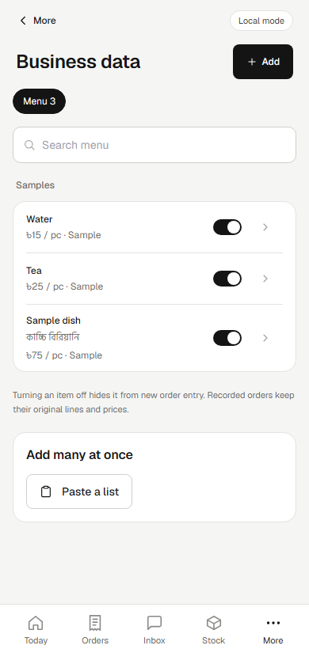
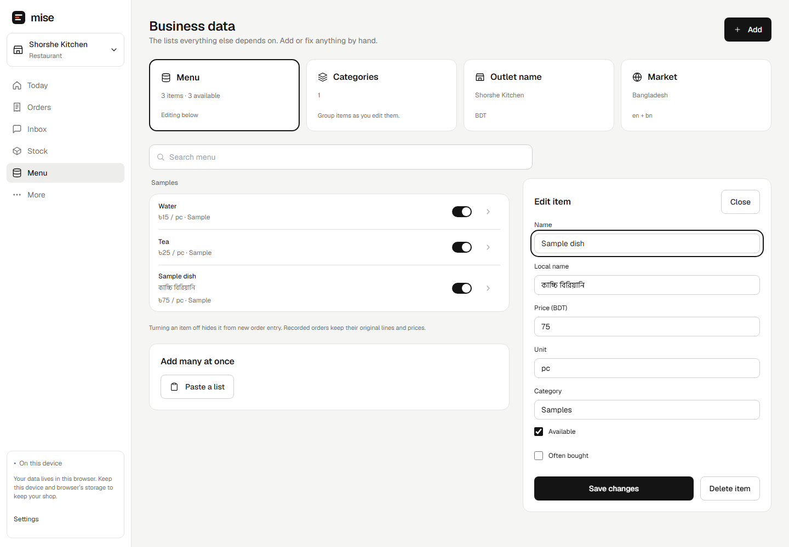
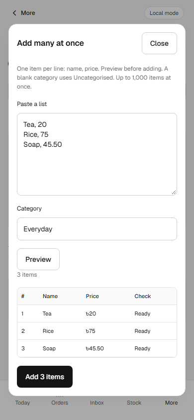

# M11 · Catalogue and business data

Item editing now supports English/local names, exact minor-unit prices, units, categories, availability and often-bought flags. Categories are created or reused while editing. Search covers names, local names and units. Bulk paste accepts one `name, price` per line, previews valid and invalid rows, and commits up to 1,000 items together. Failed imports roll back every item, category and audit event.

The catalogue and editor work offline after the first load. Desktop editing stays beside the list; phones use a native dialog with keyboard focus and Escape support. Turning availability off persists immediately. The shared `orderableItems` selector excludes unavailable items from entry; M12/M14 consume this contract when their entry screens arrive. Recorded sales/order lines must keep their original snapshots.

## Validation

- Lint and strict TypeScript/Astro checks.
- 60 unit tests, including exact price parsing, category reuse, audit history, atomic rollback and 200-item search below 50ms.
- 74 browser checks, including catalogue CRUD at 390/1440px, offline editing/reload, a 200-item bulk import, five responsive widths and axe AA checks for the editor and paste preview.
- 77 visual comparisons: 64 landing/setup, seven M10 shell and six M11 catalogue captures.
- All 270 supplied exports are present; production source/image guards pass.

The full report is uploaded as `visual-qa` by [main CI](https://github.com/tanzir71/mise/actions/workflows/pages.yml?query=branch%3Amain). Each run's summary links to its artifact.

## References and scope

- `screens/mobile/M28 · Manager — Business data (menu, tables, suppliers, payments).png` · `106:787`
- `screens/desktop/Desktop 14 · Mise — Settings › Business data (menu, ingredients, suppliers, devices…).png` · `74:2354`

Both source PNGs and live Figma contexts were inspected. The implementation reuses the actual exported toggle SVGs, row/card geometry, type and desktop list/editor split. Later supplier, device, QR, OCR and connected-channel controls are omitted until their milestones. No separate editor/paste frame was supplied; these states extend the reference's field/card primitives. Capture-only phone navigation positioning is documented in the report.

## Screenshots

## Live

https://tanzir71.github.io/mise/app/

Delivered directly to main under the owner's workflow. Next: M12, the cash-first counter calculator and sales log.
