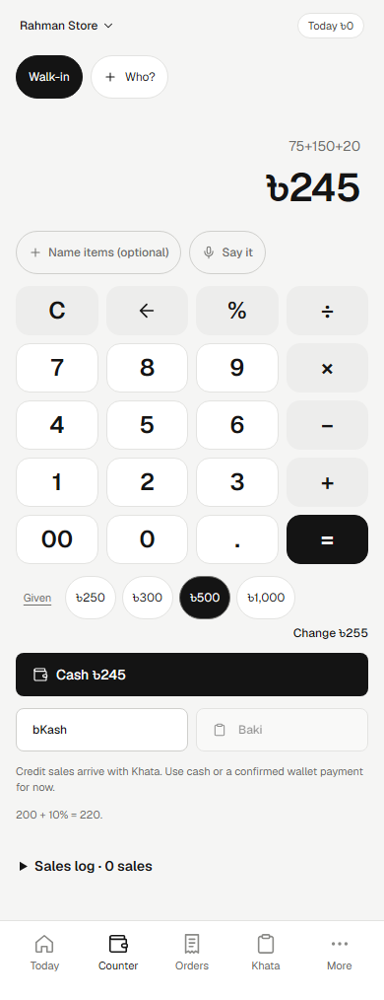
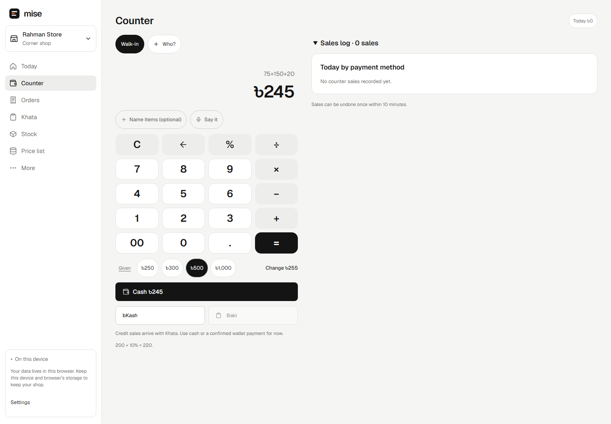
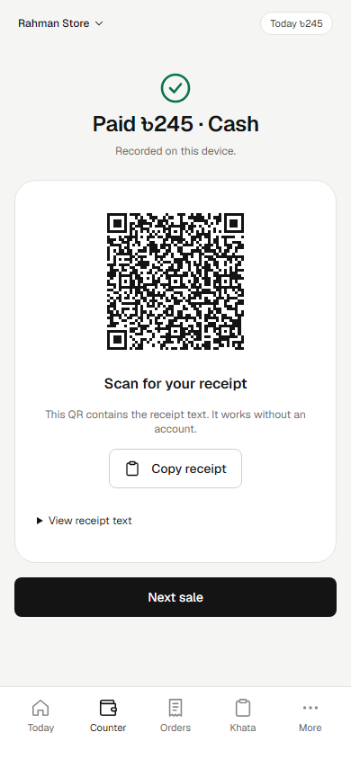

# M12 · Cash-first counter

The counter records cash in one tap from a valid total, with a 4×5 calculator keypad, operator precedence and percentages. Round given amounts show exact change; Given opens manual entry. Walk-in is the default, previous local counter names become optional chips, and catalogue names can be attached without changing the entered total. Their prices are labelled before adjustments. Unavailable items are hidden from naming/entry and stale prices are rejected.

Wallet/card recording requires confirmation after checking the payment. Baki remains disabled until M13. Sales, audit events and one-time undo within ten minutes persist atomically on this device. Today and the counter log show recorded day totals in the outlet timezone; currencies remain separate. A database upgrade from version 1 retains the shop, catalogue and audit history.

Receipt QR codes contain the actual saved receipt text, including the calculation, total, payment, given/change, optional name/items and any existing HTTPS shop link. An independent decoder verifies the content. Oversized receipts retain all their text and Copy; blocked clipboard access reveals a selectable text field. QR generation is bundled locally and cached for offline use. Optional browser speech previews a calculation and is hidden offline or where unsupported.

## Validation

- Lint and strict TypeScript/Astro checks.
- 131 unit tests, including 49 calculator cases, 13 speech cases, sale/undo validation, currency/day grouping, atomic rollback and database upgrade preservation.
- 88 browser checks. New coverage includes ten offline keypad-only sales in under 60 seconds, manual given/change, repeated-click protection, wallet confirmation, unavailable item filtering, real QR decoding, copy/size fallbacks and five responsive widths. Axe AA checks cover the counter and receipt.
- 83 visual comparisons: the previous 77 plus counter, receipt and sales log at 390/1440.
- All 270 supplied exports are present; production source/image guards pass.

The report is uploaded as `visual-qa` by [main CI](https://github.com/tanzir71/mise/actions/workflows/pages.yml?query=branch%3Amain). Run summaries link to the complete artifact.

## References and scope

- `screens/corner-shop/C01 · Owner — Counter · tap the amount, cash is one tap (with change).png` · `110:162`
- `screens/corner-shop/C03 · Owner turns phone to customer — scan for receipt, save the shop.png` · `110:384`
- `screens/corner-shop/C00 · Owner — Today at the corner shop.png` · `110:5`

Source exports and live Figma contexts were read. Existing exported icons match their slots; the keypad keeps C01's size/type/spacing and C03 supplies receipt geometry. Dynamic QR content replaces the illustrative reference pattern. Desktop adapts the phone counter beside a sales log in the existing shell; no separate desktop counter frame was supplied. C00 supplies day-total/list primitives, while later credit, order and stock panels remain staged. Touch targets expand smaller reference buttons to 44px. Captures record any navigation positioning used only for screenshot readability.

## Screenshots

## Live

https://tanzir71.github.io/mise/app/counter

Delivered directly to main under the owner's workflow. Next: M13, customers and khata.
