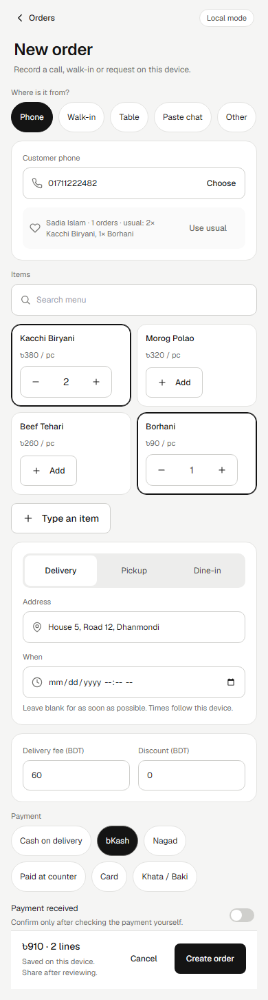
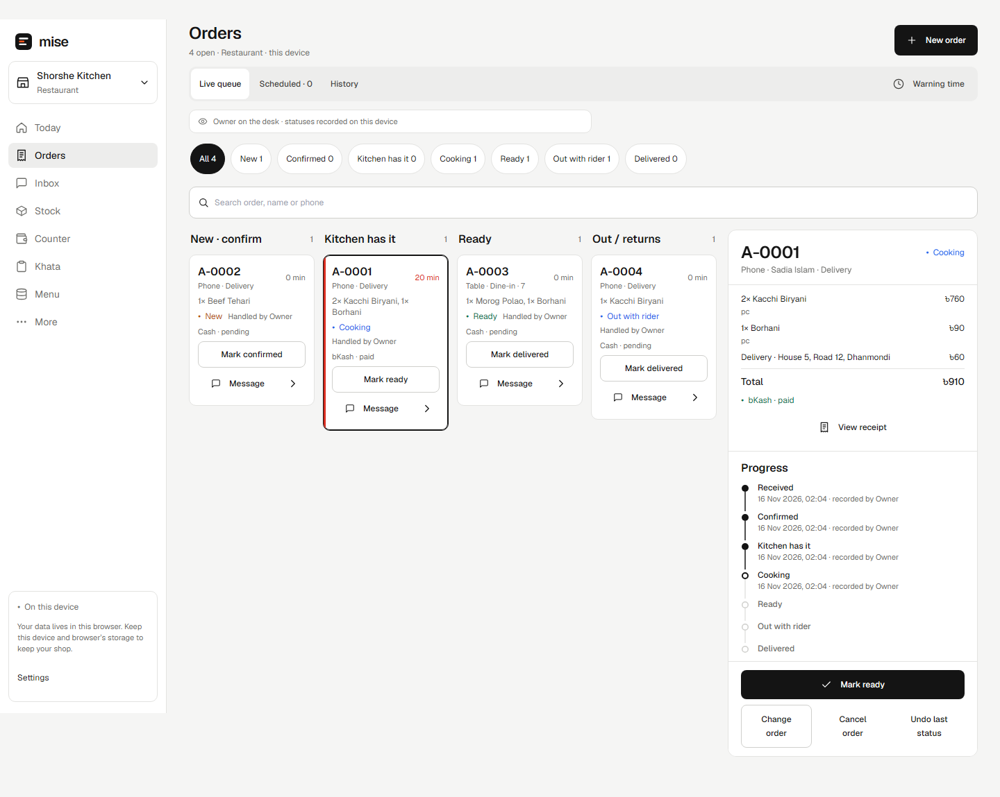
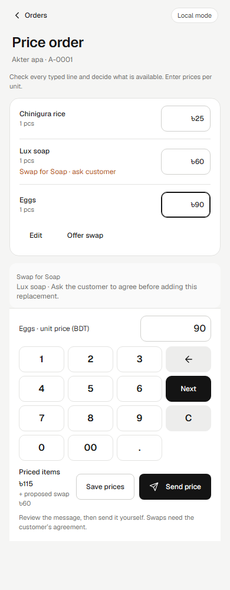

# M14 · Manual orders and queue

The app now supports manual orders on one offline device, with the phone queue and desktop board at `/app/orders`, creation at `/app/orders/new`, and per-order detail, editing and pricing views. The shared landing retains its tanziro.com credit and compact Reads anything section.

Orders record the source, original request, customer contact snapshot, catalogue or typed lines, fulfilment, schedule, payment choice, fees and discount. Phone lookup finds saved customers; Use usual refreshes catalogue prices. A new order can record a confirmed payment or a checked khata charge atomically. Pending orders remain honest about money still owed. Available catalogue tiles have quantity controls; typed items can stay unpriced until the owner checks them.

The queue has search, business-flow status filters, scheduled/history views and a configurable waiting warning. Late orders use a 3px left bar on a white card. Each card names the actual local member. Status changes are manual observations recorded on this device; the detail view shows their actor/time history and can undo the last status change without losing later notes.

Pricing supports a per-unit keypad, fractional quantities, unavailable lines and manually entered swaps. A swap requires explicit customer agreement before advancement or settlement. Quotes follow Bangla/English settings and use reviewed WhatsApp, Copy, a manual clipboard fallback and an explicit sent action. Long quotes are reviewed and logged in parts. No photo/OCR reading, remote kitchen acknowledgement, agent activity, courier sync or public tracking is claimed in Phase 1.

Payments link to retained receipts and credit entries. Cancellation returns unpaid credit and records any collected amount owed back. Partial refunds record actual returned money and its method. Corrections retain the journal, and cancellation undo waits until recorded refunds have been corrected. Edits retain the revision they opened from; another tab cannot silently overwrite a newer order. Existing contact snapshots remain valid when the saved customer's phone changes.

## References and assets

All six full Figma contexts and screenshots were read before implementation:

- M15 `102:593` — new order.
- M13 `102:288` — phone queue.
- M14 `102:448` — detail and progress.
- Desktop 09 `53:1251` — board and 360px detail panel.
- C06 `111:366` — corner-shop orders.
- C07 `111:519` — manual pricing and swaps.

The app reuses shared cards, buttons, modal sheets, toggles and exported icons. The four original timeline SVGs were downloaded from the M14 context into `apps/web/public/order-timeline/`; their 100px intrinsic widths and 42/32/14px heights remain unchanged in the 12px marker slots. Marketing screens remain image exports.

Phone controls are 44px, and desktop card actions wrap onto clear rows. The desktop detail header and footer stay visible while its content scrolls. Waiting-time captures install the test clock before page load and advance it only in the visual fixture. The capture harness resets the detail scroller after asset decoding.

## Verification

The local suite includes desktop keyboard-only and phone touch-only creation under 20 seconds, offline status changes and undo with later notes, the four business flows, exact price/swap handling, manual sharing, payments, cancellation, partial refunds, credit consent, stale edits, refreshed usual orders, duplicate-tap prevention and waiting/search behaviour. Axe and overflow checks cover the form, queue, detail and pricing at 360, 390, 768, 1024 and 1440px.

The production build, lint, type checking and all 210 unit tests pass. The first UI release passed all 118 browser tests and [CI and Pages](https://github.com/tanzir71/mise/actions/runs/43756474508). Its [visual report](https://github.com/tanzir71/mise/actions/runs/43756474508/artifacts/14178477566) contains 95 comparisons, including all six M14 references. A focused follow-up verifies scheduled orders stay out of the live queue until due and then receive the configured warning; this brings the browser suite to 119 tests. Orders were also rerun with no feature override, and the desktop creation form was separately inspected at 1440px.

The [live queue](https://tanzir71.github.io/mise/app/orders) and [new order form](https://tanzir71.github.io/mise/app/orders/new) are enabled by default. A returning-browser check updated the published settlement build to the UI release without changing schema 5. It retained two sale IDs, one customer ID, two ledger-entry IDs, all seven existing audit IDs and the 175 credit balance. Offline, it created an order, recorded Priced, added a note, undid the status and reloaded with the note intact. No page errors occurred. Both regional tanziro.com footer credits remained visible.

M14 is complete. M15 Stock is next; the broader handover goal remains active.

## Key captures

