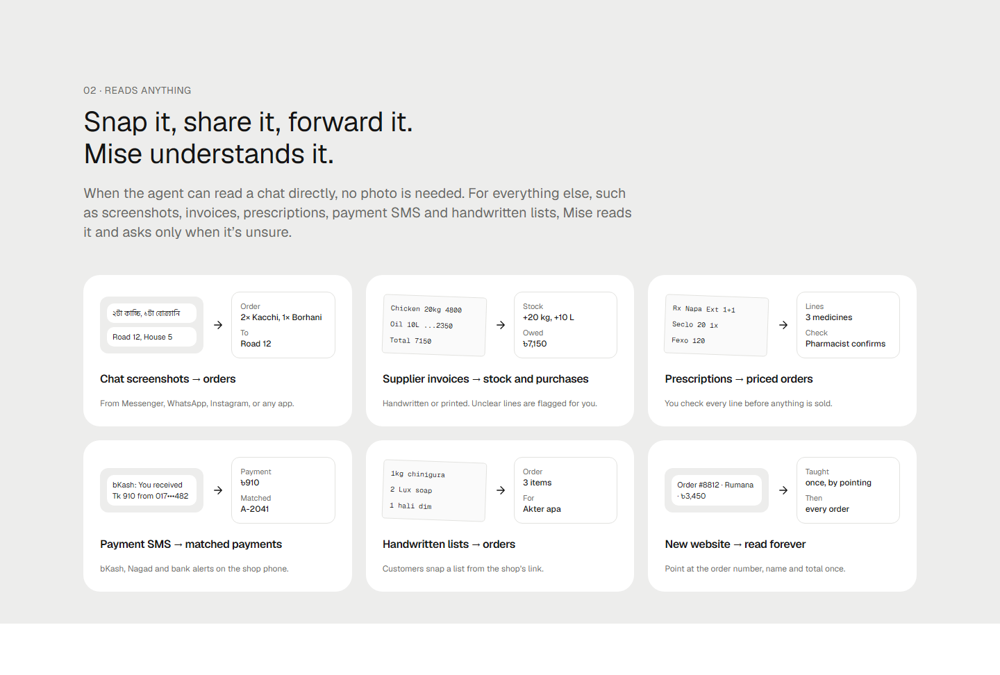
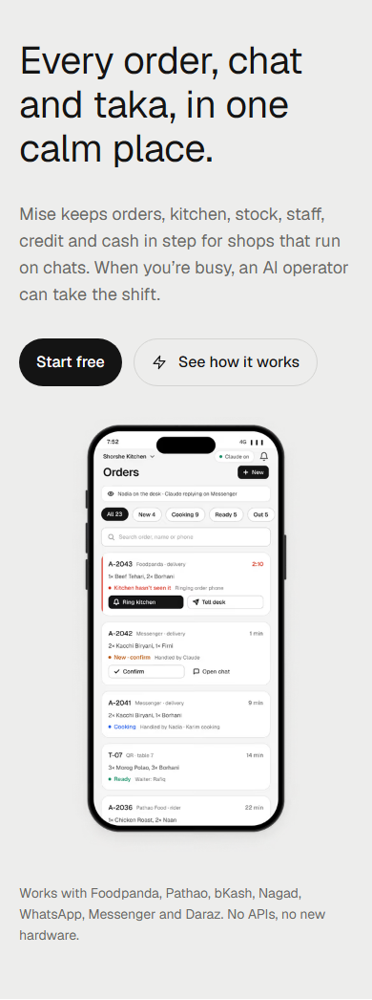
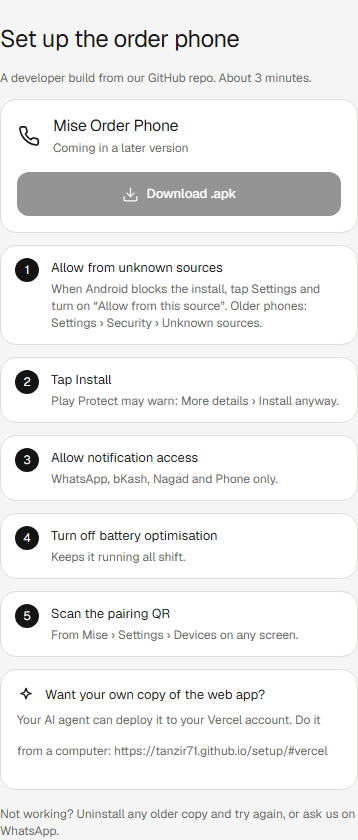

## Milestone
M10 · Part 1: local data foundations (`handover/docs/phases/phase-1-local-app.md`)

## What shipped
Setup commands now validate a shop profile, normalise its phone to E.164, seed the selected business/market packs and create three clearly marked sample items. The Dexie adapter persists the profile, samples and full audit event in one transaction. Audit-write failure rolls everything back; reopening retains data and subsequent setup saves preserve identity without duplicating samples.

Money remains integer minor units, including IDR's ISO two-digit minor unit. Formatting preserves cents even at the largest safe integer amount and uses lakh grouping for Bangladesh/India. Phone helpers cover the supplied markets, Bangla digits and an international fallback. Business packs provide the shell's changing nouns and bottom navigation.

This PR adds the storage/offline dependencies and `localApp` flag, default off. It changes no product UI. M10 remains unchecked until the next PR completes onboarding, settings, the responsive shell, offline navigation and visual verification. The generated dependency lockfile accounts for most changed lines; handwritten implementation/tests are kept small.

## Visual QA artifact
The CI artifact link will be added when uploaded. The unchanged landing/setup pages remain in the 64-comparison report.

## Screenshots (unchanged published UI)

M10 UI references read and prepared for the next PR: M12 `102:82`, Desktop Today `38:474`, M27 `106:564`, M33 `107:794`. All 270 exports are present; live Figma design context/screenshots are available again. The three-question onboarding scope takes precedence over M33's later device-integration checklist.

## Flags
- `localApp`: default off until M10 UI completion.

## Test plan
- [x] Lint, strict TypeScript/Astro checks and production build.
- [x] 35 unit tests: market defaults/nav, phone normalisation, money precision/grouping, setup validation, audit data, reopen persistence, transaction rollback and concurrent first-run saves.
- [ ] CI repeats the 57 existing browser checks and 64 visual comparisons.
- App offline acceptance is tested with the user-facing shell in part 2; no service worker is registered yet.

## Docs
- [x] CHANGELOG and DECISIONS updated; M10 roadmap checkbox deliberately remains open.
- [x] Corrected the visual-QA onboarding example's mobile reference path.

## Live URL (after merge)
https://tanzir71.github.io/mise/app/ (existing preview until part 2)
