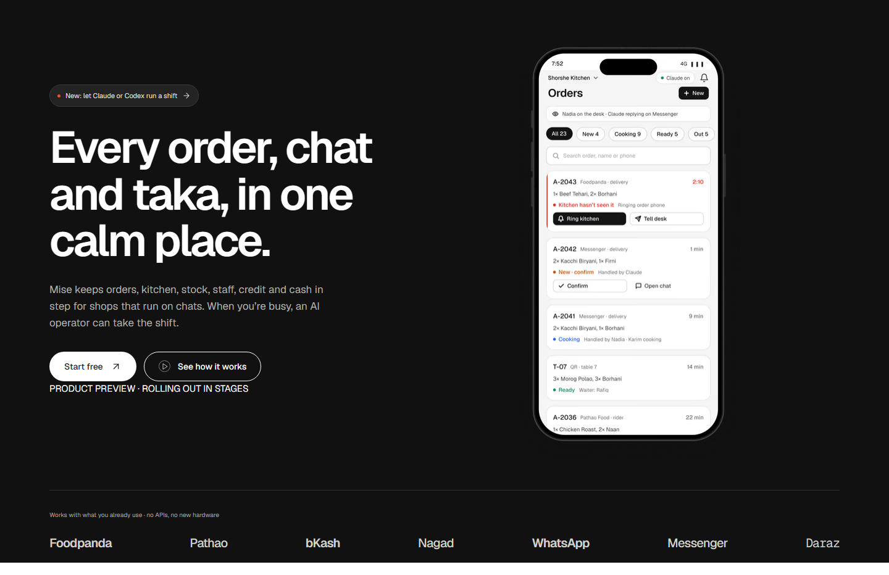
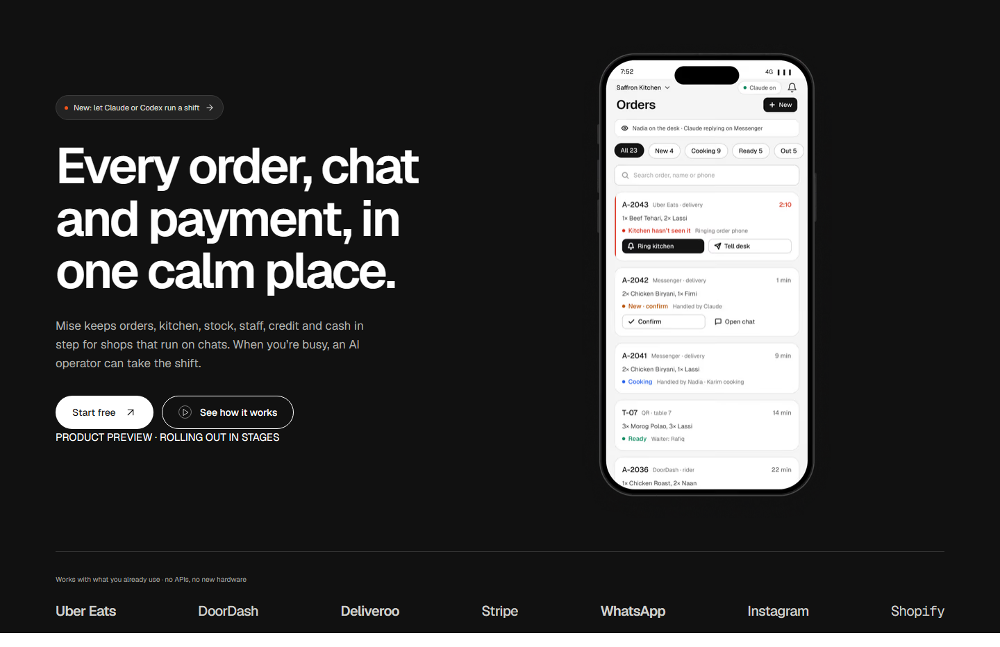
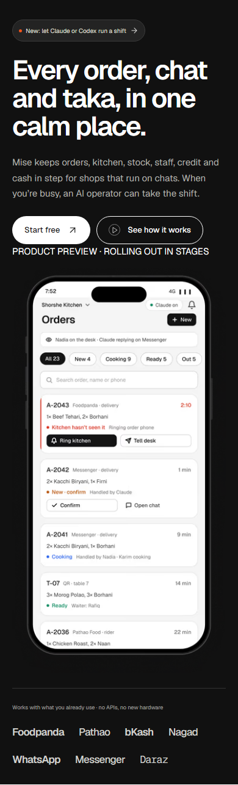

## What shipped

One Astro Picture component loads the exact `landing-assets.json` slots through `@figma`. Both regional pages render all 23 supplied product exports. Each picture has AVIF/WebP variants at 1× and 2×, a PNG fallback, source-derived dimensions and the supplied alt text. Hero images load eagerly at high priority; other pictures are lazy.

Deleted the drawn device/screen component and its CSS, including bezels, browser chrome, fake tickets and notification callouts. The export already contains its panel and shadows. Supplied Figma icons are used as masks when available; unmapped names use Lucide.

Build and CI guards reject old mockup classes, missing formats/variants, more than 120 inline SVGs and image payload overruns. A fixture confirms the source guard catches a redraw.

## Validation

Lint, strict type checks, 11 unit/integration tests and all 32 browser checks pass locally. Both pages have 23 Figma pictures and 29 inline icon SVGs. The 2× hero AVIF is 88KB; all detail pictures are under 140KB. The browser checks verify loading priority, alt text, decoded images and CLS <0.05, alongside existing accessibility and responsive coverage.

## References and screenshots

All `hero.visual`, `detail.01–12`, `day.01–06` and `businesses.01–04` mappings in `handover/exports/landing-assets.json`. Images are preserved without cropping, redrawing or extra frames. The calm layout comes in R2; detailed section matching remains R3–R6.

Per prompt 05, screenshots precede the R7 report harness.

## Deployment

https://tanzir71.github.io/mise/bd/ · https://tanzir71.github.io/mise/intl/
