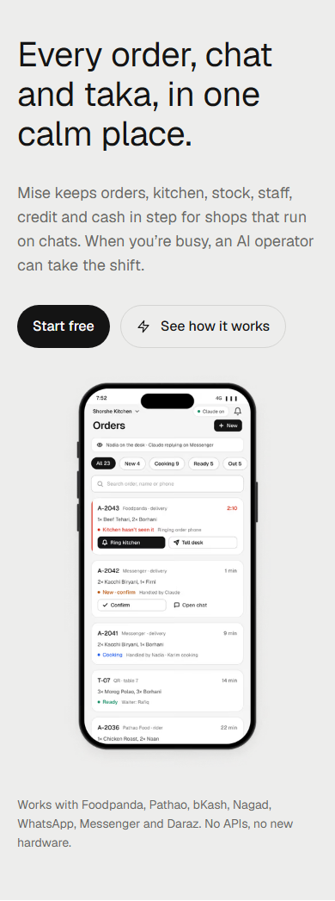
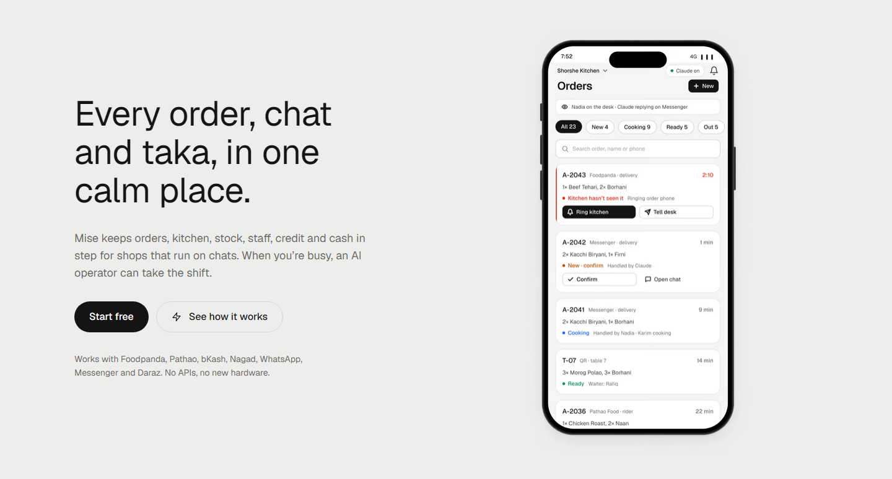
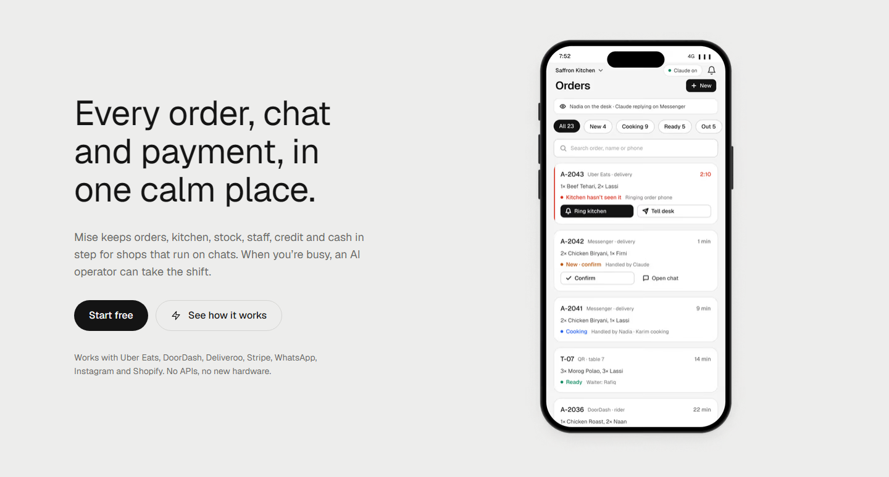

## Milestone

R2 · Calm navigation and hero (`handover/docs/09-refinement-appendix.md`).

## What shipped

Both regions now open with the light #EDEDEC navigation and hero, a 56/62 Regular headline, the supplied lead and quiet trust line, two plain actions and one exported phone. Removed the eyebrow, notification chips, laptop, partner strip, preview caption and deprecated hero copy. The complete phone image retains its shadows and is aligned to the reference.

The sticky navigation gains a bottom rule after scrolling. Phones use a light full-screen menu with native focus management, Escape support and an expanded state. At smaller widths the hero follows headline → lead → actions → phone → trust, with 40/46 type and a 240px picture. Shared logo instances no longer show ®.

Small secondary text is slightly darker (#6A6A67) than the reference to meet WCAG AA on #EDEDEC. Everything else follows the supplied hero geometry; later section matching remains R3–R6.

## Screenshots

| 390 px | 1440 px |
|---|---|
|  |  |

Reference files in `handover/exports/landing/`:

- `Nav · BD.png` — Figma 113:4
- `Hero · BD.png` — Figma 116:927
- `Nav · Intl.png` — Figma 120:2354
- `Hero · Intl.png` — Figma 120:2371
- `lp-bd-hero-phone.png` and `lp-intl-hero-phone.png`, through `landing-assets.json`.

Per prompt 05, screenshots precede the R7 report harness.

## Flags

- [x] No new flags.

## Test plan

- [x] Lint and strict type checks.
- [x] All 11 unit/integration tests and 38 browser checks pass locally.
- [x] Hero geometry, mobile menu, sticky state and no overflow at 360, 390, 768, 1024 and 1440px.
- [x] Existing regional routing, setup, accessibility/axe, picture loading and CLS checks pass.
- [x] All 76 landing exports present; no drawn-screen markup; both regions have 23 pictures and 21 inline icons. Hero 2× AVIF is 88KB; image budgets pass.
- [x] No offline behavior introduced in this static milestone. Supplied Bengali/৳ imagery remains intact.

## Docs

- [x] CHANGELOG updated.
- [x] R2 roadmap checkbox ticked; R3–R7 remain unchecked.
- [x] Contrast and intrinsic-shadow alignment choices recorded in DECISIONS.

## Live URL (after merge)

[Bangladesh](https://tanzir71.github.io/mise/bd/) · [International](https://tanzir71.github.io/mise/intl/)

Owner review checkpoint: `handover/prompts/05-refinement.md` requires “Stop after R2 so I can check the hero before you continue.” R3 will wait for that review after this deployment.
