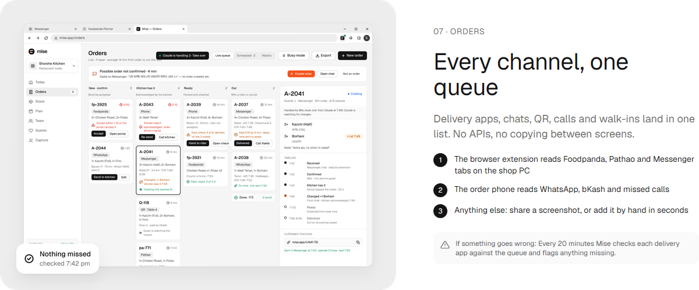
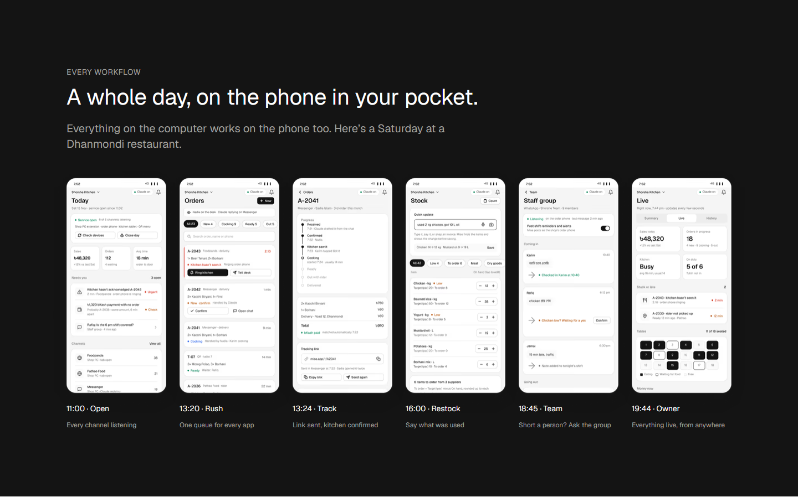
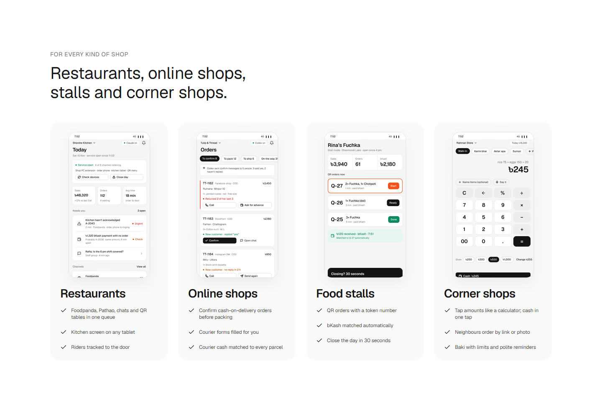

# R4 visual review

Implementation is ready for the owner sign-off required by refinement appendix R4. The hero was approved after R2. Review Operations in detail, A day with Mise and Businesses before R4 merges.

Preview: http://127.0.0.1:4321/bd/#detail and http://127.0.0.1:4321/intl/#detail while the local preview server is running. Public Pages currently contains the merged R3 layout; R4 deploys after sign-off and merge.

## Three sections for sign-off

### Operations in detail

Reference: [Operations in detail · BD](../handover/exports/landing/Operations%20in%20detail%20%C2%B7%20BD.png). Full captures: [Bangladesh](screenshots/r4-bd-detail-1440.png), [International](screenshots/r4-intl-detail-1440.png), [390px](screenshots/r4-bd-detail-390.png).

### A day with Mise

Reference: [A day with Mise · BD](../handover/exports/landing/A%20day%20with%20Mise%20%C2%B7%20BD.png). More: [International](screenshots/r4-intl-day-1440.png), [390px](screenshots/r4-bd-day-390.png).

### Businesses

Reference: [Businesses · BD](../handover/exports/landing/Businesses%20%C2%B7%20BD.png). More: [International](screenshots/r4-intl-businesses-1440.png), [390px](screenshots/r4-bd-businesses-390.png).

## Section geometry at 1440px

Heights in pixels; both regions are within 7px of the supplied section heights. These are layout measurements, alongside manual image comparison.

| Section | Reference | Bangladesh | International |
|---|---:|---:|---:|
| Nav | 89 | 89 | 89 |
| Hero | 774 | 774 | 774 |
| Feature index | 283 | 282 | 282 |
| Agent controls | 1612 | 1609 | 1609 |
| Reads anything | 969 | 972 | 972 |
| Data capture | 1376 | 1378 | 1378 |
| Checks built in | 1380 | 1380 | 1380 |
| Operations in detail | 7784 | 7784 | 7784 |
| A day with Mise | 895 | 898 | 898 |
| Businesses | 986 | 985 | 985 |
| The basics | 696 | 697 | 697 |
| Comparison | 840 | 842 | 842 |
| CTA | 391 | 394 | 394 |
| Footer | 305 | 312 | 312 |

All 14 section pairs were checked against the supplied BD/Intl PNGs. Sixty captures cover all sections at 1440 and 390px, plus the first operation. Mobile layouts stack the desktop reference in reading order. R5 will add the specified closed detail/check disclosures and shorten the page; R6 will replace the setup page and OG cards; R7 will add the automated pixelmatch HTML report and CI artifact.

## Recorded choices

- Keep the approved hero. Section headlines are 40px Regular, CTA 48px Regular, and detail titles follow the updated written 40px Regular rule.
- Section leads match the references at 20/28; hero lead stays 18/28. Slightly darker secondary text on #EDEDEC meets AA.
- Retain the supplied copy JSON, including detail numbers that differ from the reference.
- Keep the required Setup and downloads footer link in the region column.
