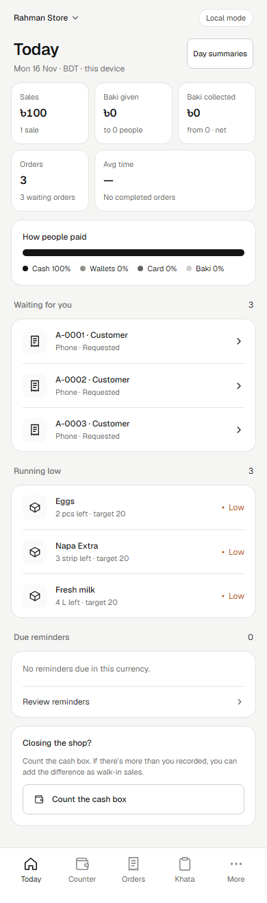
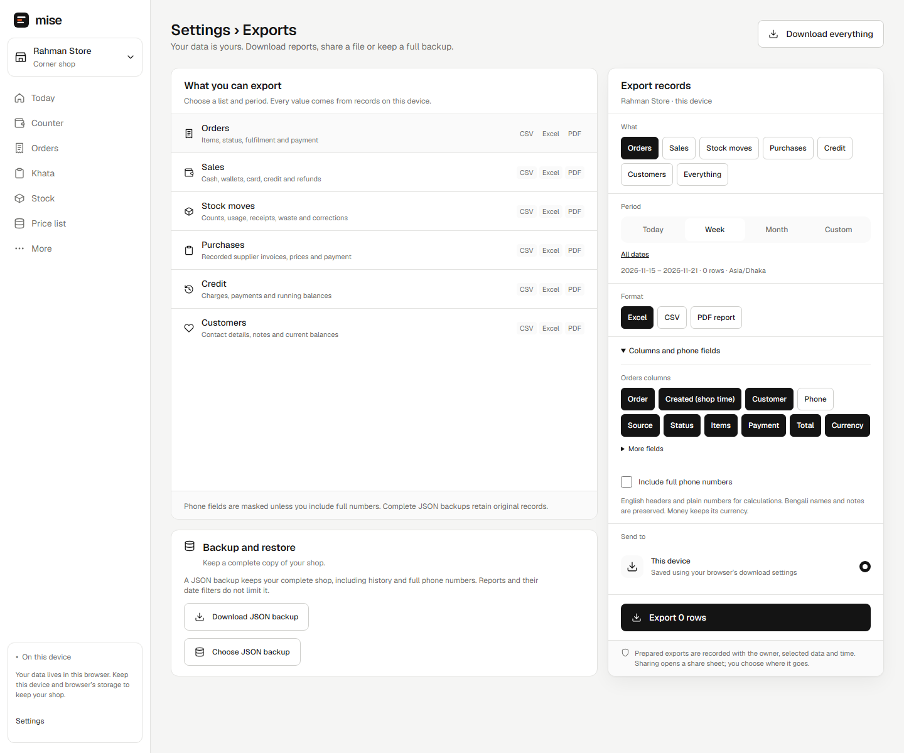
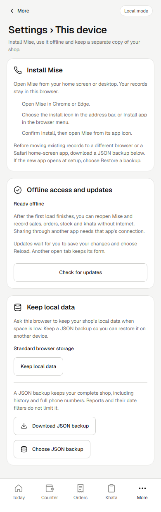

# Mise v0.2.0 — Useful on one device

[Open Mise](https://tanzir71.github.io/mise/app/) and set up your shop in three questions. Install it from your browser, then run sales, orders, stock and khata offline after the first load. Records stay on this device; full JSON backups let you restore them in another browser.

## Included

- M10: business and market packs, three-question setup, phone navigation, desktop sidebar, local settings and an audited IndexedDB workspace.
- M11: catalogue editing, local item names, exact prices, categories, availability, search and reviewed bulk paste.
- M12: cash-first counter, calculator keypad, given/change, optional customer/items, manually confirmed wallet/card payments, receipts, QR and sales-log undo.
- M13: customers and khata, balances and limits, explicit over-limit choices, payments/corrections, history, and bilingual reminder/receipt handoffs.
- M14: manual orders, queue/board, customer lookup and usual orders, typed-item pricing and swaps, fulfilment/status history, warnings, payment, cancellation and refunds.
- M15: stock targets and pack-rounded needs, reviewed quick updates, night counts, movement corrections, suppliers and bilingual order drafts.
- M16: record-derived Today totals and payment splits, waiting orders, low stock, due reminders, reviewed cash closing, saved summaries and same-day undo.
- M17: six datasets in CSV, Excel and PDF with dates/columns and masked phone fields; complete twenty-table JSON backup, reviewed atomic restore and native file sharing with download fallbacks.
- M18: installable manifest and original Mise icons, install guidance, offline relaunch, explicit updates, native storage-protection requests and direct backup/restore access.

## Verification

All 323 unit tests, 176 browser tests and 107 visual comparisons pass in [CI and Pages](https://github.com/tanzir71/mise/actions/runs/43817947818). [Download the visual report](https://github.com/tanzir71/mise/actions/runs/43817947818/artifacts/14203746677).

The published app was checked with full Chromium and Microsoft Edge: valid native installability checks, real storage requests and backup fallback, browser close/reopen offline, cached manifest and another recorded sale. Public backup/restore preserves all twenty source tables and identical totals. The checks include five responsive widths and axe accessibility tests. Lighthouse retired its PWA category; current native checks replace that obsolete score. Physical Android/iPhone installation is not claimed.

Local workflows are available without an account. WhatsApp and other outbound handoffs use the chosen app and retain copy/manual fallbacks. Customer shop links and paste-to-order are the next phase.

## Screenshots

See the [M18 delivery audit](https://github.com/tanzir71/mise/blob/v0.2.0/docs/m18-delivery.md) for the Phase 1 requirement mapping and published evidence.
